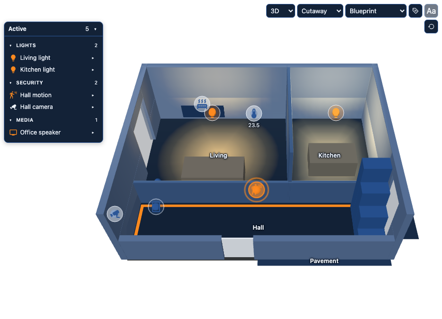
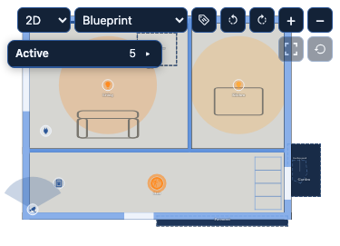
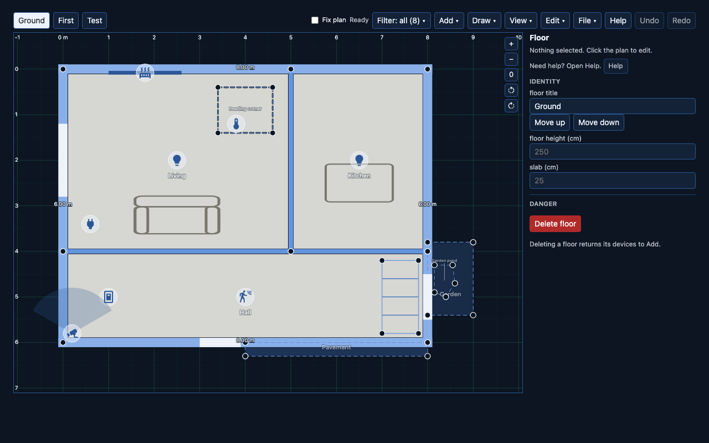
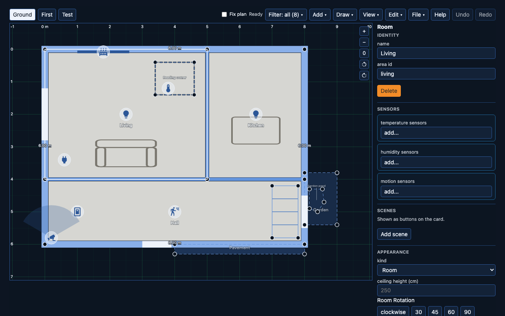
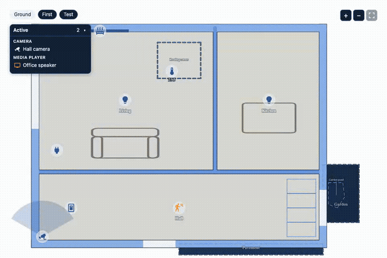
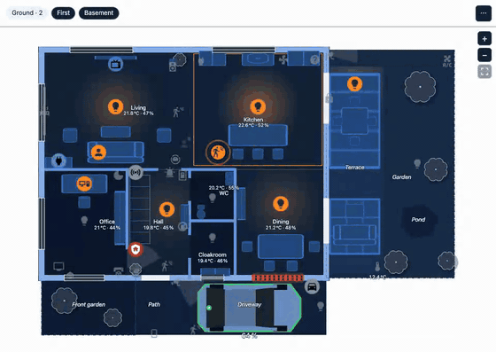
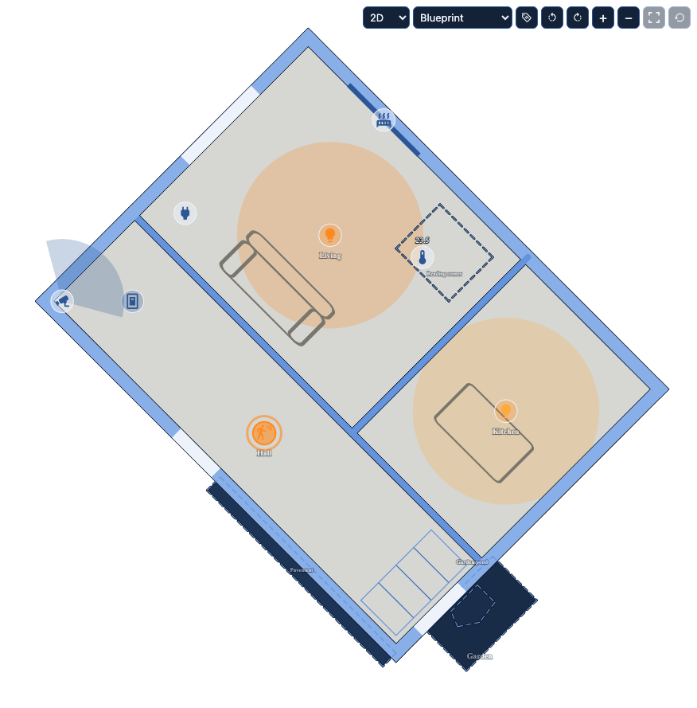
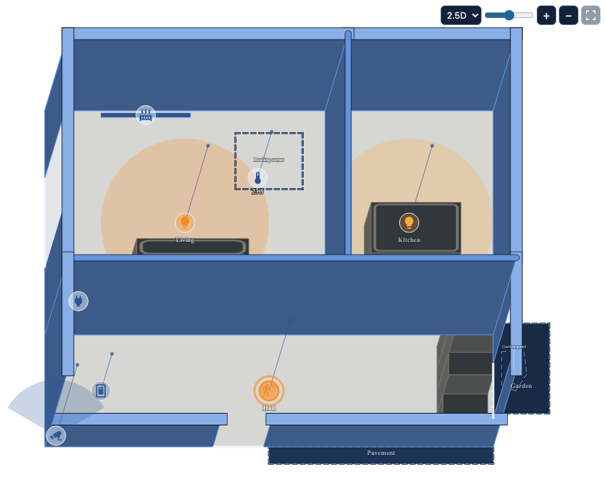

# Floorplan Studio

The floor plan with a real editor. Draw your home in 2D, 2.5D or 3D inside
Home Assistant, attach your devices, and use it as a live dashboard. No
external drawing tool, no YAML per element.

What is wrong comes first (an open window, an armed alarm), then what is on.

Installable through HACS. Needs Home Assistant 2025.6 or later. Releases are
in [`CHANGELOG.md`](CHANGELOG.md). MIT licence.



## On a phone

A bottom sheet you drag. The house stays above it.



## The Studio

The editor is a panel in Home Assistant. Draw floors, rooms, walls, doors and
furniture, pick an area for a room and an entity for a device. File, Load demo
gives you the furnished three-level home shown here.





## Thirteen themes

One key, `theme:`. Every plan below is the same ground floor.


## See it move



## Replay the day

⋯ > Replay plays back the last 24 hours from Home Assistant's history. Live leaves it.



## What you get

- An editor panel in HA: draw floors, rooms, walls, doors, windows (also slit windows), open doorways, stairs,
  furniture. Attach rooms to areas and devices to entities from pickers. The
  device type menu lists the common types first (light, switch, motion,
  window / door sensor, temperature, speaker, TV), then the rest A to Z,
  including siren, alarm and fan.
- A dumb light on a smart switch is one icon: bind the switch to the light
  ("Controlled by") and the plan shows both as one lamp.
- A 2.5D view, in the card (`view: 2.5d`, or the View dropdown beside the zoom
  buttons) and as a read-only preview in the editor: walls rise, furniture
  becomes boxes, the near walls are cut down so every room shows. A Tilt
  slider turns it from top-down to side-on.
- A switch to hide every name and value (`labels: false` on the card, View, Labels,
  Names and values in the editor), so only items and sensors are left.
- Turn the plan in 45 degree steps with the ⋯ menu's Rotate items (smooth, text
  stays upright; `rotation` sets the start). The card remembers each viewer's
  zoom, position, rotation, 2D or 2.5D and theme in their browser, and Reset
  view in the ⋯ menu returns to the card's config.

  

  
- A Lovelace card: lights, switches, sensors, cameras, thermostats, doors,
  people, mmWave radar targets and vacuums shown live. A lit lamp throws a
  pool of light; motion pings and fades from red to grey, and its room gets a
  thin red line inside the walls while it is on; an open door or
  window turns red and dashed; a TV turns blue; a playing speaker sends out
  waves; a siren or an armed alarm turns red. A TV, speaker or computer drawn as
  furniture and linked to an entity acts like the device of that type: blue at
  rest, the on colour when on, tap for more-info. A car is a furniture piece in one of nine models and any colour,
  with a main entity and up to 24 attached ones: away (faded, in 3D truly see-through), charging (green outline and bolt),
  battery or fuel level, an unlocked door as an alert. A tap opens its more-info, a hold lists its entities. The plan
  darkens after sunset. Icons grow with a large house, and
  `icon_size` scales them further.
- The card keeps its chrome beside the plan, not over it: a header with the floor
  tabs, **Search** and a **⋯** menu for everything about the look (view, theme,
  labels, layers, rotate, reset), and one **Overview** sheet (Overview, Floor, Room,
  Device) with what is wrong first and what is on after: a side sheet from 640 px
  (a rail when folded), a bottom sheet you drag on a phone. Tap a row for the same popup
  as a tap on the plan. The card never grows taller than the screen, every
  control is 44 px on a touch screen, and Tab reaches the devices on the plan
  with the arrow keys.
- A tap on a device, door or Active row, in 2D and 3D, opens a small popup that
  operates nothing: the name, the state, one big button (Turn on, Turn off,
  Open, Close, Lock, Unlock), sliders for a light's brightness, colour
  temperature and colour when it has them, and a More info link. Turning
  anything but a light off asks once more. A hold still opens more-info. A
  mouse hover shows the name and state. `tap_action` and `hold_action` change
  that for the whole card (popup, more-info, toggle, nothing). A fan has a speed
  slider in its popup.
- Pinch, drag and double-tap to zoom and pan on a phone, Ctrl/Cmd+wheel and
  drag on a desktop. In the 3D view, drag turns the house; the middle button,
  or Space plus a drag, pans. A kiosk mode strips the card down to the plan for a
  wall tablet.
- Adding or editing the card shows a form, not raw YAML: theme, floors, fade,
  room glow, zoom, kiosk, night, icon size, open-door colour, the Active
  list, all in the Lovelace UI.
- A card can pin a `center` and `zoom_level` to one room, corridor or part of
  a home, so a dashboard can show several cards, each zoomed to a different
  place. The editor's View menu has a "Copy card view" button that writes
  the two lines for whatever it's currently showing.
- **File → Install code** in the editor writes a whole dashboard, not just
  the card, ready to paste and matched to your plan's theme and floors.
  The same panel gives three lines for a strategy dashboard instead, which
  Home Assistant rebuilds on every load, so a floor you add later shows up on
  its own.
- **Heat map.** A card key `heat_map` (and View, Heat map in the editor, and the card's ⋯ menu) fills each room by its
  temperature or humidity on a fixed scale, with the value and a legend. Live readings, no history.
- **Favourites.** A card key `favourites` lists entities at the top of the Overview, each with its button.
- **View → Saved views** keeps a named view (floor, mode, turn, zoom) in the
  layout; every card offers it in its ⋯ menu.
- A scanned or photographed plan can be traced: load it in the editor, scale
  it to a real measurement, draw over it, then hide or drop it. It never
  reaches the card.
- A skill that turns photos of your architect's plans into a first draft.
- **File → Export** also hands an AI assistant every entity you have in Home
  Assistant, so it can place and wire up your devices from that one file,
  offline, without inventing an entity id. See below.

## Colours, themes and customization

Thirteen built-in themes, picked from the card's Edit-card form or written as
`theme:` in YAML. `ha` follows your Home Assistant dashboard's own theme;
the rest are fixed palettes. `blueprint` is the default. The grid at the top
of this page shows all thirteen: blueprint, midnight, light, slate, terminal,
solarized, ha, coffee, a-team, space, cyberpunk, carpenter-brut, beach-house.

Every room keeps its own paint (colour or texture) in every theme — only the
grid, walls and device icons change. `blueprint`, `slate`, `terminal`,
`coffee`, `a-team`, `space`, `cyberpunk`, `carpenter-brut` and `beach-house` are all built
from the same four-role system (base, foreground, line, accent) in
[`src/core/theme-roles.ts`](src/core/theme-roles.ts) — pick four colours and
get a whole theme, no ~50 hexes to hand-tune. See
[`docs/SPEC.md`](docs/SPEC.md#role-generated-themes-s421-2026-09-22).

## Install

[](https://my.home-assistant.io/redirect/hacs_repository/?owner=vespassassina&repository=ha-floorplan-studio&category=integration)

The button opens HACS on your Home Assistant with this repository ready to add. You need [HACS](https://hacs.xyz) installed first. Or by hand:

1. In HACS, search for **Floorplan Studio**. If it is not listed, open ⋮ → **Custom repositories**, add `https://github.com/vespassassina/ha-floorplan-studio` with type **Integration**, then search again. Download it and restart Home Assistant.
2. Add the integration: [](https://my.home-assistant.io/redirect/config_flow_start/?domain=floorplan_studio) (one click, no fields). Home Assistant does not load a custom integration until it has an entry, so this step cannot be skipped.
3. Open **Floorplan Studio** in the sidebar and draw, or load a draft (below).
4. Add the card: `type: custom:floorplan-studio-card`. No resource to add; the integration does it. For a whole premade dashboard, or the exact code for your plan's theme and floors, use **File → Install code** in the editor — see [`docs/card.md`](docs/card.md#a-premade-dashboard).

The sidebar link is on by default. To hide it: Settings → Devices & services → Floorplan Studio → Configure → turn off **Show in the sidebar**. The card and your saved plan keep working; turn it back on any time.

Updates arrive through HACS like any other.

The card is a file plus chunks: `www/floorplan-studio-card.js`, `www/floorplan-studio-3d-<hash>.js` (the 3D view, fetched only when someone picks 3D), `www/floorplan-studio-form-<hash>.js` (the Edit-card form, fetched only when someone edits the card) and one small file per language. The HACS download holds them all. If you install by hand, copy the whole `custom_components/floorplan_studio/` folder, `www/` included, never the card file alone.

A card config, by hand (the Edit-card form in the Lovelace UI does this for
you, no YAML needed — see [`docs/card.md`](docs/card.md#the-edit-card-form)):

```yaml
type: custom:floorplan-studio-card
floors:
  - ground
  - first
fade: 120
room_glow: true
theme: blueprint
zoom: true
kiosk: false
```

## Start from photos or architect drawings

Give an AI assistant your drawings, it gives you back a `layout.json`, you open it in the editor and fix what is off. No drawing the outside walls by hand.

It works from a **skill** and a **schema**, two files any assistant can follow (Claude, ChatGPT, Gemini, Grok, Copilot):

- [`prompts/SKILL.md`](prompts/SKILL.md): what to do, in order. It asks you for one real measurement and where north is, then draws, then checks its own work.
- [`prompts/SCHEMA.md`](prompts/SCHEMA.md): the file format, written for an assistant to read.
- [`prompts/examples/`](prompts/examples/): a flat and a two-floor house, both valid.

**How to load them into your assistant, step by step: [`prompts/README.md`](prompts/README.md).**

To check what an assistant gave you, run `npm ci` once in a clone of this repository (Node 20 or later; the check needs `esbuild`, which `npm ci` installs), then `node scripts/validate-layout.mjs layout.json`. It prints `ok`, or one line per problem: metres written as centimetres, a room outside the walls, a door on no wall.

## Let an assistant place your devices too

Tracing gets the walls right; it never touches devices, on purpose — a
drawing does not know which lamp is which. Once your plan is drawn and
connected to Home Assistant, **File → Export** downloads a `layout.json` that
also carries `available`: every entity Home Assistant knows about, its name,
its area, and the room on your plan that area already has, if any. Hand that
file and `prompts/SCHEMA.md` to an assistant and it can add and position
devices for you — using only the entity ids actually listed, never a guessed
one — with no Home Assistant connection of its own. Open the result back in
the editor, check it, Save.

The field only appears in a file you exported yourself, with Home Assistant
connected. It is never part of Save or the plan Home Assistant stores; it is
dropped again the next time the file is opened or re-exported.

## Develop

```bash
npm ci
npm run lint        # eslint and tsc
npm test            # unit tests
npm run build       # dist/ and custom_components/floorplan_studio/www/
npx playwright test # editor tests; PW_PORT=5400 to run beside another checkout
```

After a build, open `dist/editor.html` in a browser to use the editor with no
Home Assistant and no server.
Work is split in tasks (`docs/PLAN.md`), run with the flow in
`docs/WORKFLOW.md`. Decisions are in `docs/DECISIONS.md`. Notes for AI
assistants working on the code are in `CLAUDE.md`. Contributing by hand: see
[`CONTRIBUTING.md`](CONTRIBUTING.md). The layout format itself:
[`docs/schema.md`](docs/schema.md).

## Licence

MIT. Icons are Material Design Icons (Apache 2.0).
