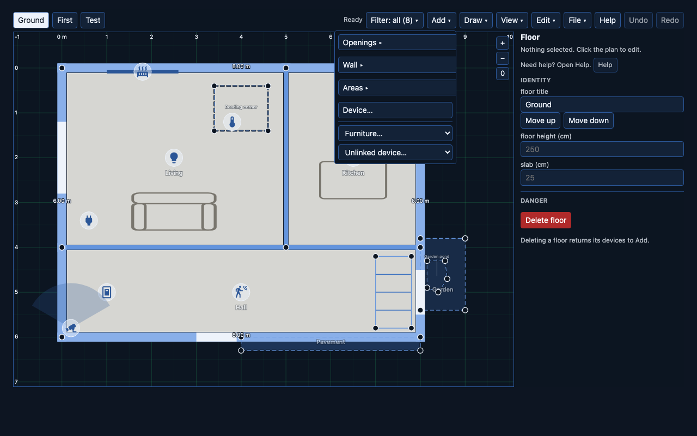
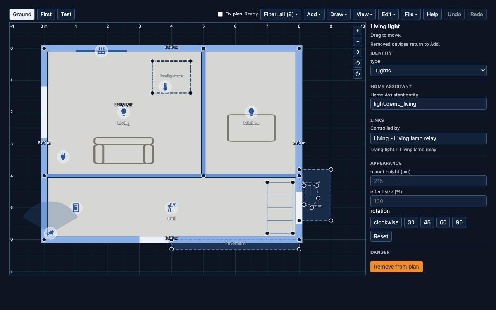

# The editor

Draw your home, floor by floor, and attach it to Home Assistant — walls,
rooms, doors, stairs, furniture, devices. Runs two places, same code:

- **Inside Home Assistant**, as a sidebar panel — draws, saves straight to
  `.storage`, and (where a writer is configured) reads and writes Home
  Assistant itself: areas, entities, helpers, groups, automations.
- **Standalone**, as `dist/editor.html` — open it directly from disk
  (`file://`), no server, no Home Assistant. Draws and exports/imports JSON
  files; nothing about Home Assistant is available here.

## The toolbar

Left to right:

- **Floor tabs** (`Ground`, `First`, ...) — switch floors; the new floor's plan slides in
  (none under reduced motion). A new floor comes from Floors, Add floor: it starts with the outline and stairs of the first
  floor.
- **Filter: all (N)** — filters which device types are drawn, so a crowded
  plan can be thinned out while you work.
- **Add** — every drawable thing: openings (door, open doorway, window, slit window, gap; the type selector also offers Glass door and Full-height window), a wall of a
  given kind, areas (zone, structure, stairs), furniture, an unlinked
  appliance icon, and (inside Home Assistant) entities from your instance.
  Device, inside Add, is the catalog of every device on this layout, placed
  or not.
- **Floors** — Add floor, Align to floor below…, Move up, Move down, Delete floor….
  Align lays this floor over the one below it. It needs a floor below, and Lock plan refuses it. The faint lines are the
  floor below, drawn while Align is open; the floor you are aligning stays where it is on screen, so Move right sends
  the faint lines left (the panel says so). The Inspector's panel, top to bottom:
  - **Auto align**: the score, then the change in words ("Turn 2.5° anticlockwise, move the centre 38 cm left, 90 cm
    down"). When another turn fits about as well, one more line names it ("A half turn (177.5°) fits about as well
    (68 %). Check the plan before you apply it."); it is never applied for you. Apply writes the turn and the offset
    (one undo step; disabled and reading "Already aligned" when nothing would change). A move, a turn press or an undo
    does not search again; a changed wall does.
  - **Move**: four buttons, up, left, right, down as drawn on screen (a turned view still moves the right way), by the
    **Step** you pick: 1, 5 (default) or 50 cm.
  - **Turn**: anticlockwise and clockwise about the floor's centre, by the **Angle step**: 0.1, 0.5 (default), 1 or 3
    degrees. The centre stays where it is in the house.
  - **Keys**: the arrow keys move and `,` `.` turn, by the same steps, while Align is open and no text box has focus
    (outside Align the arrows pan). A held key is one step. Each press is one undo step.
  - **Offset and Rotation**: boxes that show the stored values (0.1 cm, 0.01 degree) and take typed ones, one undo step
    per change; text that is not a number changes nothing. **Reset** sets both to 0 in one step.
  - **Stairs**: each stair of this floor with the nearest stair below (distance, and degrees off for a straight flight),
    live on every press. **Align stairs** lays this floor's first stair on the stair below nearest to it (the one the first row of the list names), moving and turning it
    (a round stair only moves), and says what it did; one undo step.
  The two step choices are kept in this browser (not in the plan, not an undo step).
  While Align is open the plan is read-only: a press only pans (the wheel still zooms), nothing is selected, dragged or
  deleted, and the right-click menu is off, on the plan and in the Outline (a click on an Outline row of this floor centres
  it and selects nothing; the Menu key on a row does nothing). Starting a draw closes Align. A typed offset or rotation past the
  coordinate limit says so in the status line.
- **View** — how the plan looks while you work: snap grid, measure grid, lengths, a Labels submenu (Device names, Names and values),
  Floor below (the floor under this one as faint lines, kept in this browser, no undo step),
  Preview night, theme, Detail (Auto, Full or Minimal), Heat map (Off, Temperature or Humidity), Camera thumbnail (On/Off, size, position), Saved views, Re-center and Fit to window. The editor draws the plan
  flat only; 2.5D (and soon 3D) is a way to look, so it lives in the card.
  Everything here that is about looking, not editing, is in the card too:
  see "Studio and card" in `card.md` for the list, and for what is left out on
  purpose. A new view control needs a row there (a test checks).
- **Edit** — what changes the plan or Home Assistant: Add floor, the Home
  Assistant popover (inside Home Assistant), Group, plan rotation, Device
  colours, Trace image…
- **File** — Save, Open, Export, Reset.
- **Help** — a step-by-step guide in the side panel, for someone who has
  never used the editor before. It stays open while you work, so you can
  follow a step and do it without the guide getting in the way. Escape or
  its own Close button puts the side panel back to normal.
- **Undo / Redo** — one step per gesture; a drag that ends back where it
  started adds no step.
- **Status line** — right of Redo: what just happened ("Saved", "Edited",
  an error). A long message is cut with an ellipsis; hover it for the full
  text.

## Names and values

View, Labels, Names and values hides every room, zone and structure name and every
sensor value on the plan, leaving icons and state. It does
not touch the Names button (device names, off by default), the Lengths and
the measure grid, which are editor aids rather than plan text. It is not an undo step, is not saved in the layout and goes back to
shown on reload. The card's own switch is `labels: false` in its config.

## The side panel

Click anything on the plan — a room, a wall, a device, furniture, stairs — and
its panel replaces the default "Floor" panel on the right: what it is, its
fields, and a Delete button. Click empty canvas to go back to the floor panel.
Panels for entity-backed things (rooms with an area, devices) also show
Home Assistant context — the room's helpers and automations, a device's
more-info — where a writer is configured.

A **car piece** has a **Car** block. **Model** lists the nine models, each with a top-view swatch; picking one sets the
footprint to that model's (a size you typed is replaced; Undo brings it back) and drops a typed height, in one undo step.
**Colour** is the layout's palette, a colour input, or Theme colour; a colour that is not a built-in swatch joins the
palette in the same step. **Main entity** is the entity a tap opens (trackers are listed first). **Attached** lists the
other entities: the main entity's device first, then entities named like the car, then trackers, sensors, locks, climate
and covers, diagnostics last, up to 24. **Add all from this car** attaches the device's entities in one step. Each change
is one undo step, and none when the value does not change. **Convert to car piece** is on an unlinked car appliance (it keeps its turn, colour and attached) and on a car device icon
(its entity becomes the main one); it selects the new piece.
Changing the symbol of a car piece drops its three car keys, so the layout still saves.

A plug's panel has a Power sensor picker: the `sensor.*` of device class
`power` that measures it. A plug is active only while that sensor reads 2 W or
more. Placing a plug (Add, a room's area, the catalog) fills the picker when its
Home Assistant device has exactly one power sensor; with two or none it stays
empty and you pick. Empty also means the card looks for the sibling itself at
runtime. One pick is one undo step; picking the same sensor again is none. The same sensor tints
the plug in the card by its draw (card options `plug_heat_from` and `plug_heat_to`); the
editor's own plan shows no live state, so the tint is for the card.

### Heights

Every height is optional, in cm (0 to 1000). The field shows the default as
its placeholder; clearing it removes the value, so the default applies again.
Junk is refused with the reason.

- **Floor** — height (storey, 250) and slab (floor thickness, 25).
- **Room** — ceiling height (the floor's).
- **Wall** — height (by kind: a fence 110, an edge or boundary 0, a wall the
  storey).
- **Door** and **Opening** — height and sill (a door 210 from 0, a window 120
  from 90, a slit window 60 from the wall's ceiling, an opening 210 from 0).
- **Furniture** and **unlinked appliance** — height (by symbol or type).
- **Device** — mount height, where the real object hangs (by type). A stem to
  it shows in the card's 2.5D from 100 cm up. A heater bar is drawn as a box whose top is
  this height (default 70 cm, under a window sill); a TV panel's bottom is it
  (default 100 cm; 30 cm when it stands free); a speaker's cabinet is a fixed
  20 x 20 x 30 cm and ignores it, but its icon rides it: 30 cm (the top of the
  cabinet) by default, or the height you set.
- **Device**, effect size (%) — on the devices that draw an effect (a light, a
  speaker, a media player, a motion or contact sensor, and any device whose
  entity is a `siren.*`): how big its aura, rings or waves are, 25 to 300, as a
  percent of the type's own size. Empty is 100, shown as the placeholder; a
  value outside the range is clamped and the status line says so. One undo step;
  empty removes the key. The editor draws no live state, so the effect shows in
  the card; the field is there so the layout carries the size.

Stairs take the floor's height as their rise, and a structure line is flat.
A stair has a Direction select: Auto (shown with what it resolves to on this
floor), Up, Down, Up and down. Auto removes the field. Pick Up and down for
stacked stairs on a middle floor, Down where a flight only leads below.

A device's panel shows one extra field for a few types:

- **Person** — a "Room sensor" field, below the entity field: point it at a
  second entity (a BLE room-presence sensor) whose state, or `area_id`/`area`
  attribute, names one of your rooms, and the card glides the icon there. It
  refuses the person's own entity, since that isn't a room sensor.
- **mmWave radar** — a "Targets" field: add or remove `x`/`y` entity pairs,
  one row per tracked target, each pointing at the two sensors an ESPHome
  LD2450 (or similar) exposes for that target.
- **Vacuum** — nothing extra; point `entity` at the `vacuum.*` entity. There
  is no field for the robot's position, since most integrations expose that
  as a camera or a proprietary blob, not coordinates.

## What Floorplan Studio made in Home Assistant

Inside Home Assistant, Edit, Home Assistant opens a small popover (drag it
by its head, close it with the X or Escape) listing every helper,
automation and area the editor created, labelled `floorplan-studio`, across
the whole instance. Only what the editor made is listed: a light, automation or
area you labelled yourself is left alone, and Remove double-checks. (Areas are
remembered per browser.) Click a name to open the item where Home Assistant edits
it: a helper's dialog, the automation editor, the area page. Remove deletes
it from Home Assistant after a confirmation; the plan is not touched either
way. The button is disabled while there is nothing to list.

## Placing a room's devices at once

Select a room linked to a Home Assistant area and the panel shows "Place N
Home Assistant devices" when the area has entities the plan does not show
yet. It opens a popup: one row per entity with a tick, and a chip per type
to narrow the list. Only what the plan has an icon for is offered: lights,
switches, plugs, sensors with a temperature, humidity, motion, contact or
vibration class, cameras, covers and the like. A device with several motion,
occupancy or presence sensors (one per zone) gets a row for each, named to tell
them apart; placing one leaves the others offered. The same rule holds in
Add, Device and the room menu's "Add device from". A `group` whose members are
all motion sensors counts as a motion sensor and is offered; any other group is
left out, with power, energy, illuminance and battery readings, scripts and
people. Untick what
you do not want and press Place: the ticked rows land on free spots in the
room, one undo step, ready to drag to their real place.

## Drawing a house

1. **Draw the outline.** `Draw` starts freehand outline drawing; click each
   corner, double-click (or click the first corner again) to close it.
2. **Split it into rooms.** Draw a room the same way, snapped to the outline
   and to other rooms — a room's own edges default to `wall`.
3. **Doors and windows.** `Add → Openings` places one on the nearest wall
   within 15 cm; drag it along the wall afterwards. An **Open doorway** is a
   door with nothing drawn in it: the wall is cut, and you see it only while it
   is selected or under the pointer (or in the alert colour when its sensor says
   open). Choose it over a plain **Opening** when the gap needs a name or sensors.
4. **Stairs, zones, structures.** `Add → Areas`. A zone has no wall edges (it
   can't — `wk` is forced to `boundary` throughout); a structure can. A selected zone is outlined with a heavier, dashed
   line (a selected room keeps the thin solid one), so it still reads as a zone.
5. **Furniture and devices.** `Add → Furniture` places a symbol you can move,
   resize and rotate. `Add → Entities` (inside Home Assistant) or
   `Device → <unplaced item>` places something tied to a real entity.
6. **Attach an entity.** Select a device, pick it from the entity field in its
   panel — a filterable combo box: type part of a name, entity id or
   room/domain to narrow the list. An entity already on the plan is never
   offered twice (its own stays). Attaching a placed entity to a door's
   sensors/locks/cover, a heater's TRVs or temperature sensors, an ac's
   linked entities, or an unlinked item's list pulls its icon off the plan in
   the same step — it is now shown through what it is attached to, and
   `Device` no longer offers it either: an attached entity is in use, not
   unplaced, so it can't be placed a second time next to what already reads
   it. Detach it again (Remove, or clear the cover) and it goes back to
   `Device`, not back onto the plan.
   **Room scenes.** A room's panel has a *Scenes* section (S14.7), on the kinds that take sensors. *Add scene* makes "Scene 1" with
   every light and switch drawn in the room, on. Each scene has a name, one row per light or switch (On or Off, and for a light that
   is on an optional brightness 1 to 100 %; empty leaves the brightness alone), a Remove per row, an *add to scene* menu for the
   room's other lights and switches, and *Delete scene*. At most 12 scenes of 40 items. With Home Assistant connected the panel names
   the scenes of the room's area (the card lists them by itself) and *Offer another scene* adds a scene from elsewhere to the room's
   `haScenes`. Every press, pick or change of a field is one undo step; the same value again is none. The studio does not read the
   lights' live state, so a scene is built from the list, not captured from the lamps. The card shows the result as buttons
   (docs/card.md, Picking a room).
   **Room sensors.** A room's panel has a *Sensors* section: temperature,
   humidity and motion pickers, the same as a door's contact sensors. Each lists
   only its own kind of entity (a `sensor` of class temperature or humidity; a
   `binary_sensor` of class motion, occupancy or presence) and none another room
   already owns, at most 20 per list. A pick is one undo step and also removes a
   loose icon of that entity; Remove (a round red X, named "Remove <sensor>" for
   screen readers) only detaches. The add menu is grouped "<floor> · <room>":
   the room being edited first, then its floor's other rooms, then the other
   floors in layout order, entities with no room last in each floor, and typing
   still filters by the heading. A loose temperature,
   humidity or motion icon that sits inside a room shows **Attach to room** in
   its panel: one click adds its entity to the smallest room (never a zone)
   that holds it and deletes the icon, one undo step. The button is disabled,
   with the reason beside it, when the icon is outside every room, has no
   entity, or is already on the room's list. A layout that holds both an icon
   and the room entry (hand-edited) keeps drawing the icon in the editor, and
   its panel says "Attached to <room>".
7. **Save.** `File → Save` inside Home Assistant writes to `.storage`
   straight away. `File → Export` (either mode) downloads the JSON.

## Snapping and editing

A corner jumps onto another corner, a wall, or lines up with a neighbour.
Hold **Alt** while dragging to move freely, ignoring every snap. Drag a wall
to move it together with the corners on either end; hold **Shift** while
dragging a corner or a wall to move just that one, detached from its
neighbours. Drag a room, zone or stairs by its middle to move the whole
shape. **Delete** removes whatever is selected — corner, wall, door, opening,
device, furniture or stairs. **Ctrl/Cmd+Z** undoes, **Ctrl/Cmd+Shift+Z**
redoes. Scroll to zoom; pan by dragging the background, or drag anywhere with
the middle button, right button, or Ctrl/Cmd held.

The same text is in the editor under Help, step "Moving things and
snapping". The side panel no longer repeats it.

### Drawing: the 15 degree step and typed lengths

While you draw a wall, outline or room, a new point lands on the nearest 15
degree ray from the last point, its length on the snap grid. A corner, a T
onto an edge or an alignment with an earlier point wins inside its reach.
**Alt** turns the step off with the other snaps. Type a length ("350" is cm,
"3.5m" is metres) and press **Enter**: the next point goes that far along the
direction of the pointer. Escape clears the typed text, a second Escape
cancels the drawing. The status bar shows the 15 degree step while you draw.

### Selecting many devices

**Shift+click** toggles any device in or out of the selection. **Shift+drag**
from empty plan draws a dashed rectangle and adds every drawn device inside it;
it follows a turned view. A device on a hidden layer, or one not drawn at the
current detail, is not taken. **Ctrl/Cmd+A** selects every drawn device on the
floor, **Escape** clears. Selecting writes nothing, so it is not an undo step.
A plain drag still pans.

A drag on a member moves every unlocked member by the same delta, in one undo
step; **Delete** removes them all, in one. A locked device does not follow.

### Add device finds one entity of a hub

Add, Device… lists one row per Home Assistant device, so a gateway with 172
entities is one row. Type in its search box and a last group, **Entities**,
lists every entity whose own name or id matches ("innen", "gateway_a_7"), each
under its own name with its type and its device's name on the small line.
Pick one and that single entity is placed, typed by its kind (a temperature
sensor becomes a temperature device). The hub's own row goes, as it always did
once something of it is on the plan; its other entities stay findable by
search. Up to 50 rows show, then "50 of N. Type more to narrow it." With the
search box empty nothing changes.

### The Inspector

The side panel (the Inspector) has tabs: **Selection** follows what is
selected; **Place** (a room's Home Assistant area) and **Add** (Add, Device…)
open as modes in the panel, so the plan never moves; **Link** shows while
Edit, Link lights to switches is open. With several devices selected the
Selection tab counts them by type and offers **Controlled by** (binds every
light to one switch, and says how many others it left alone), **Lock** (ticked,
unticked or half-ticked when mixed) and **Delete n**; each is one undo step.
To bind twenty lights: Shift+drag over them, open Controlled by, pick the
switch. One Undo unbinds them all.

**Link lights to switches** does not write at once. It lists each unbound light
with the switch it would get, in the selection, else the selected room, else the
floor. Untick what should stay and press Apply: one undo step.

### Lock

One word everywhere. **Lock plan** (the toggle at the top, "Plan locked" or "Plan
editable") holds the geometry: corners, walls, doors, windows, kinds, stairs and
furniture. Names, colours, textures, areas, devices and links stay editable, a car's colour and attached entities too (its model sets its size, so that stays locked). The
**Lock** box on a device, a piece of furniture or an unlinked appliance stops it
being dragged; on a wall, door or opening it reads "Lock (keeps its length)".
A refused edit says "The plan is locked." with an **Unlock** button in the banner.

### Right-click and the status bar

A right-click on a device, a selection, stairs, a line, a door, an opening, a
wall, furniture, a room or the empty canvas opens one menu per object, with the
same items in the same order; the Outline's rows open the same menu. Under the
canvas a status bar reads the facts of the moment ("4 selected · Living · Snap
10 cm · Ground · 100 %"), and "Plan locked" with an Unlock button while locked.

## Looking around: buttons, keys and memory

Beside the zoom buttons (`+`, `-`, `0`) are **Rotate view left** and **Rotate
view right**: 45 degrees a press, animated (about 0.35 s a step, none with
`prefers-reduced-motion`). The turn is added to the plan's own rotation (Edit,
Rotate the plan) and is only a way of looking. It is not in the layout, not in
a saved file and not an undo step. A zoomed view keeps its centre and zoom as
it turns; a view that shows the whole floor is refitted. `0` is **Reset
view**: the whole floor, the plan upright.

| Key | Does |
|---|---|
| Up / Down arrow | zoom in / out |
| Left / Right arrow | turn the view left / right, 45 degrees |
| Space | Reset view |
| Cmd/Ctrl+S | Save, the same as the Save button |
| Ctrl/Cmd+Z, Shift for redo; Delete | as before |

Precedence, first match wins:

1. **Cmd/Ctrl+S** goes first and works everywhere in the editor, a text box
   included. The browser's own save-page dialog
   never opens. Shift+Ctrl+S is left to the browser. An empty plan is not
   written: the status line says there is nothing to save.
2. **Typing wins over the view keys.** In a text box, number box, text area,
   select, range slider or editable text (the combo filter box included), the
   arrows and Space are the field's. Space on a focused button, summary, link
   or checkbox presses it. Arrows on a focused button turn or zoom the view.
3. The view keys work with or without a
   selection. There is no arrow nudge of a selection, so nothing competes
   with them. **Alt+arrows** are the same keys.
4. Keys are heard on the editor only, not on the page: a second editor or any
   other input on the page is not touched. Delete, Backspace, Escape and
   Ctrl/Cmd+Z are unchanged.

The editor remembers how you look, per browser, under
`floorplan-studio:view` in `localStorage`: the floor on show, the names toggle, the turn, and the zoom and centre of every floor that
is not shown whole. Theme, grid, measure grid, Preview night and Help already
had keys of their own. It is saved 150 ms after the last touch, and when the
tab is hidden or closed. The plan itself is not in it: a plan that is edited,
opened or reset keeps the view. An older entry that names a 2.5D view, a tilt or a wall mode is read without them and opens flat. A floor the layout does not have is ignored,
a field that does not parse is dropped on its own, and a browser that blocks
storage just forgets. A floor the host asks for (`floor` on the element) wins
over the remembered floor. Reset view clears the zoom and turn.

## Saved views

A saved view is a named way of looking at the plan that every card offers (see "Saved views" in `card.md`). It is kept in the layout, in `views`, so it travels with Save and Export.

View, **Saved views**:

- **Save current view...** asks a name (1 to 60 characters) and **Open in**: Viewer's choice (the default), 2D, 2.5D or 3D. It stores the floor on show, the turn if the plan is turned, and the zoom and centre if the floor is zoomed in. A floor shown whole stores no zoom and no centre, so each card fits it to its own window. Enter saves, Escape cancels.
- One item per view of the floor on show. A click shows it (the floor, the turn, the zoom): that is looking, not editing, so it is no undo step and does not touch the file. A right-click, or the Menu key, opens **Rename** and **Delete**.
- Save, Rename and Delete are one undo step each; a rename to the same name is none. Delete floor removes the floor's views in the same step, and Undo brings them back. Lock plan does not stop them: a view is not geometry.
- A layout holds at most 24 views. The editor draws flat only, so a view's mode is stored and read by the card, not here.

## Detail (zoom)

View, Detail picks how much of the plan is drawn at a zoom: **Auto** follows the zoom (far out only rooms, their names
and badges, and devices that are on, alerting or unavailable as dots; closer in the icons; closest the names and
readings), **Full** always draws everything, **Minimal** always draws only the far level. The Studio starts on **Full**:
while you edit, a device you just placed must not vanish at fit. The choice is kept in this browser, is not in the
layout and is not an undo step; when it is not Full the toolbar says "Detail: Auto" or "Detail: Minimal". The levels and
thresholds are in the card's Detail section (`card.md`).

## Camera thumbnail

View, Camera thumbnail draws a small live picture beside each camera icon: On or Off (Off at start), Size (small, medium, large) and
Position (above, below, left, right of the icon). It is the same picture and the same three choices as the card (`camera_thumb`,
`camera_thumb_size`, `camera_thumb_pos`; see the card's Camera thumbnail section). The pick is kept in this browser with the view and is not an undo
step. The picture takes no pointer, so clicking, selecting and dragging the camera work as before. Inside Home Assistant it is the camera's own
`entity_picture`, refreshed every 10 seconds and paused while the tab is hidden; standalone there is no camera state, so none is drawn.

## Heat map

View, Heat map fills each room that has a reading by a fixed scale (16 to 26 °C, or 30 to 70 %) and prints its value, as
the card does: the same draw path, so the plan is the same. The pick is kept in this browser, not in the layout, and is
not an undo step. Inside Home Assistant it uses live readings; standalone there are none, so no room is heated and the
status bar says "Heat map: no readings" (it is per floor on show). With a map on, the status bar shows the scale with a
small ramp. The rules (which sensors, what is not a reading, paint and night) are in the card's Heat map section
(`card.md`). Favourites are card only.

## Rotation

A device or a piece of furniture turns from its panel's rotation buttons —
30°, 45°, 60° or 90° per click, a direction toggle, and Reset to 0. There is
no free-text angle field: every angle the UI can produce is already wrapped
into `[0, 360)`. (A hand-edited layout file can still carry an angle outside
that range — the file loader normalises it on open, same treatment as an
out-of-range furniture size.)

## Preview night

View, Preview night toggles the same dark overlay the card shows after
sunset: every room and outdoor area darkens, and a room with a light on
stays clear. The editor has no live lights, so with the preview on every
room is dark. It's a browser preference, not part of the layout — it is
never saved with the plan and never becomes an undo step.

## Trace over a scan

Edit, Trace image… opens a small panel at the bottom left of the plan.

1. **Load image…** takes a PNG, JPEG or WebP: a scan, a photo of the
   estate agent's plan, an architect's drawing. It is shrunk to 2000 px on
   the long side and stored with the floor, then placed over the outline (or
   the middle of the view on a blank floor) at half opacity.
2. **Scale…**: click two points on the image whose real distance you know, a
   wall you have measured, say. Type that distance in cm and Apply. The image
   is resized so the two points are that far apart; its height follows.
3. Draw the outline and the rooms over it as usual. While the image is shown,
   room fills are see-through, so a room you have drawn does not hide the
   scan under it.
4. **Move** lines the image up with the walls you have drawn: while it is on,
   drag anywhere on the plan to move the image (nothing under the pointer is
   selected), or press the arrow keys to nudge it 1 cm, with Shift 10 cm. The
   status bar says so. Esc, Scale, Hide, Remove or closing the panel ends it.
   **Rotation** turns the image, in degrees from -180 to 180, about its
   top-left corner. A drag is one undo step, and so is each key press.
5. **Opacity** and **Show** change how much of it you see; **Remove image**
   drops it. Each change is one undo step.

Only the editor shows the image. The card never draws it, though Save keeps it
with the plan. Home Assistant takes at most 3.5 MB in one save for the whole
plan, so Load fits the image into what the rest of the plan leaves (a single
image is never over 4 MB), lowering its quality if it must. If even that is not
enough, Load says so and changes nothing: crop the scan or remove another
floor's image. File, Export leaves it out unless you tick
**Include trace image**, so a file you hand to an assistant stays small.

## Starting from photos instead

If you'd rather not draw the outline by hand, an AI assistant can trace it
from photos or an architect's drawing and hand you back a `layout.json` to
open here and correct. See the README's ["Start from photos or architect
drawings"](../README.md#start-from-photos-or-architect-drawings) section.

## Layout files

The editor's Open and Reset both run every file through the same `validate()`
the card uses — a file that doesn't pass is rejected with the reason, and
nothing on screen changes. A layout is [schema v2](schema.md); an older v1
file is migrated on open automatically. Because a layout file is something
anyone (or an LLM) can hand you, it's treated as untrusted: a missing field
gets a sane default, an out-of-range value gets clamped or wrapped rather
than crashing the load, and only `validate()` itself is the strict gate that
decides whether the result is usable.

## Saving in Home Assistant

- **Unsaved work.** Closing the tab with edits that were not saved asks first. Leaving through HA's sidebar does not unload the page, so the editor also keeps an autosave draft in this browser. The next time the panel opens and that draft differs from the stored plan, a bar asks "Restore unsaved draft from 2026-10-21 14:03?". Restore is one undo step; Discard forgets the draft. A draft that fails validation is ignored.
- **Two tabs.** The stored plan has a revision number. A save carries the revision the page loaded; if someone saved in between, nothing is written and a bar offers Reload (take the stored plan in, one undo step, yours is one Undo away) or Overwrite (save yours over it).
- **Dark mode.** A change of HA's theme restyles the editor and leaves your edits and undo history alone.
- **Narrow screens.** The panel shows HA's menu button in a top bar.
